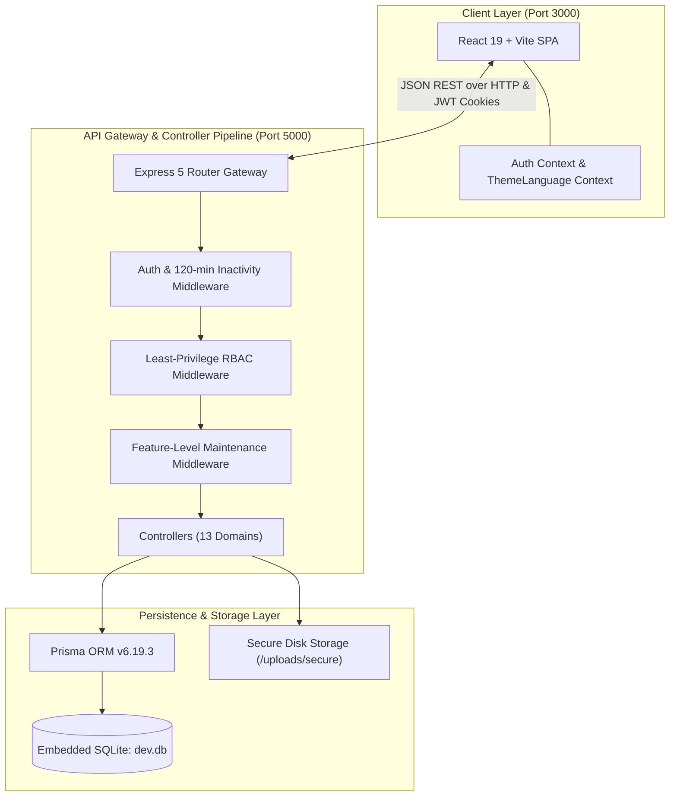
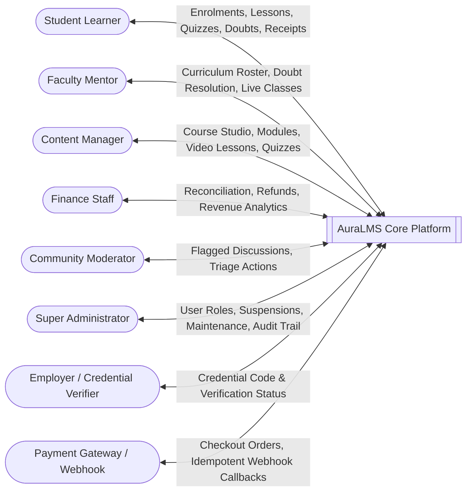
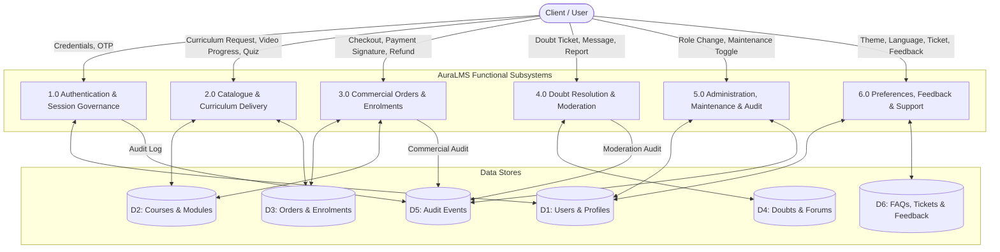
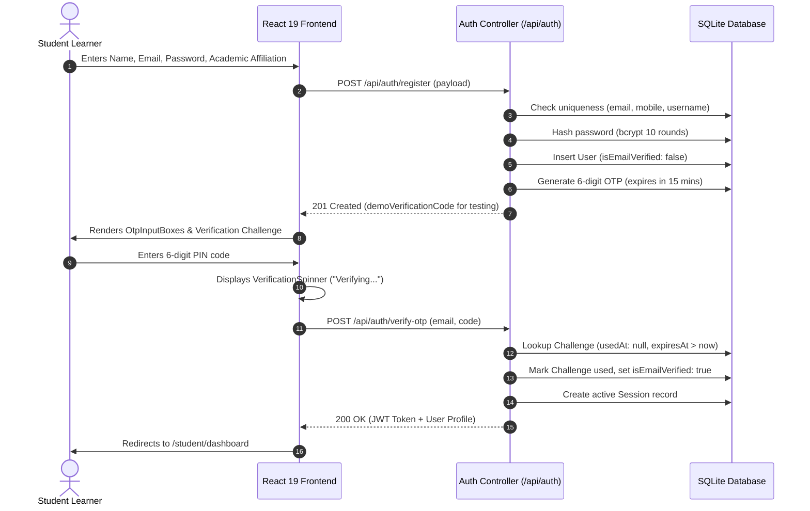
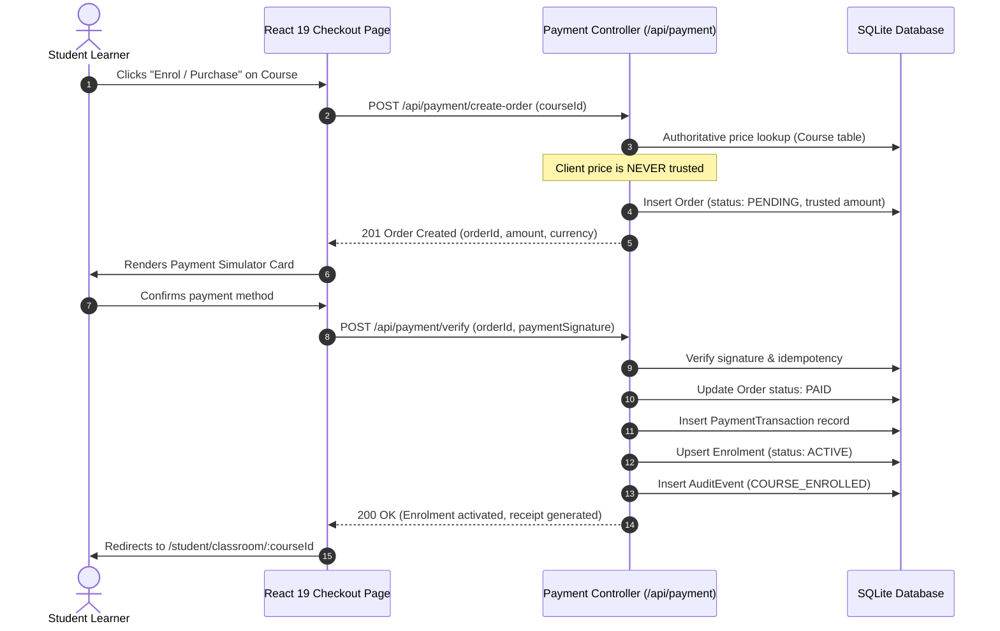
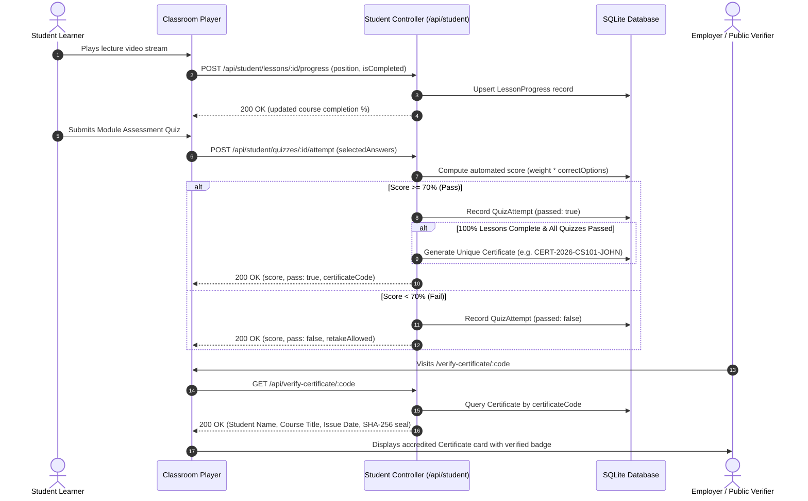
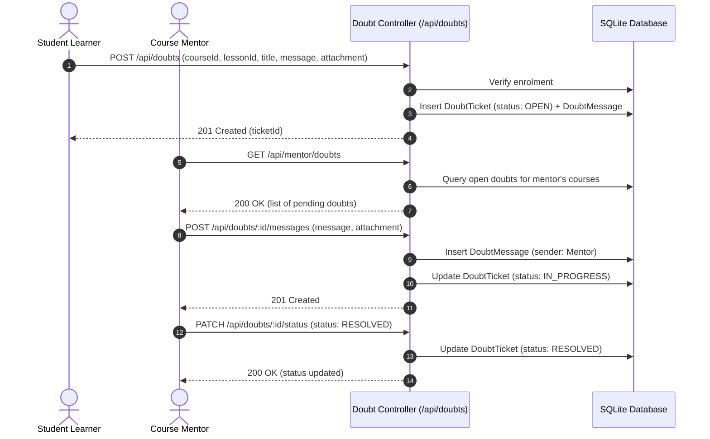
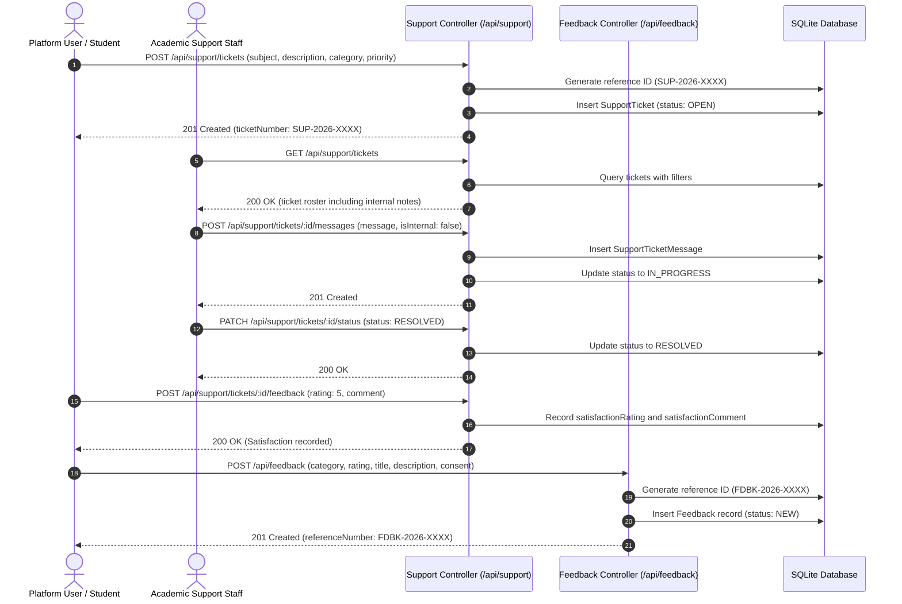

# System Architecture & Data Flow Diagrams (DFD)
## AuraLMS — Architecture Blueprint & Process Decompositions

---

## 1. System Architecture Overview

AuraLMS employs a **modern, decoupled full-stack architecture** with a strict separation between client presentation, API gateway governance, persistent relational storage, and secure disk asset storage.

---

## 2. DFD Level 0 — Context Diagram

The Level 0 context diagram models AuraLMS as a single central system interacting with external entities (Users across 6 roles, Payment Webhook Gateways, and Employer Certificate Verifiers).

---

## 3. DFD Level 1 — System Functional Decomposition

Level 1 decomposes AuraLMS into its primary functional subsystems:

---

## 4. DFD Level 2 — Detailed Subsystem Process Flows

### 4.1 Process 1.0: Registration & Expiring OTP Verification

---

### 4.2 Process 3.0: Anti-Tamper Checkout & Entitlement Activation

---

### 4.3 Process 2.0: Classroom Playback, Quiz Grading & Certificate Verification

---

### 4.4 Process 4.0: Doubts & Moderation Triage

---

### 4.5 Process 6.0: Support Tickets & Platform Feedback (Section 15)

