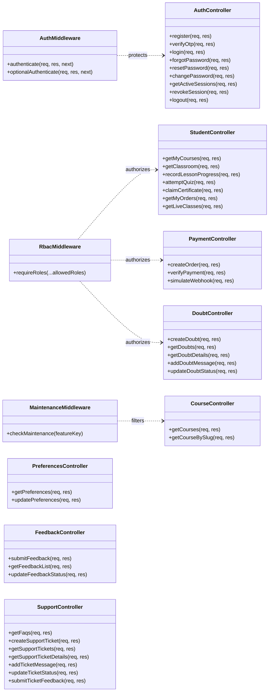

# Unified Class Diagram
## AuraLMS — Object-Oriented Domain & Service Model

This document specifies the UML Class Diagram for AuraLMS, covering persistence entities, controller modules, security services, and middleware pipelines.

---

## 1. Domain Entities & Persistence Models

```mermaid
classDiagram
    direction TB

    class User {
        +String id
        +String email
        +String passwordHash
        +String name
        +String mobile
        +String username
        +Role role
        +UserStatus status
        +String suspensionReason
        +Boolean isEmailVerified
        +DateTime lastLoginAt
        +DateTime createdAt
        +DateTime updatedAt
        +verifyPassword(password: String) Boolean
        +hasRole(role: Role) Boolean
    }

    class UserProfile {
        +String id
        +String userId
        +String college
        +String academicYear
        +String academicCourse
        +String bio
        +String theme
        +String language
        +String notificationPrefs
        +DateTime updatedAt
    }

    class Session {
        +String id
        +String userId
        +String tokenHash
        +DateTime expiresAt
        +DateTime lastActiveAt
        +Boolean isRevoked
        +String userAgent
        +String ipAddress
        +DateTime createdAt
        +isExpired() Boolean
    }

    class VerificationChallenge {
        +String id
        +String identifier
        +String code
        +ChallengeType type
        +DateTime expiresAt
        +DateTime usedAt
        +String userId
        +isValid() Boolean
    }

    class Course {
        +String id
        +String title
        +String slug
        +String description
        +String categoryId
        +CourseLevel level
        +Float price
        +Boolean isFree
        +String thumbnail
        +CourseStatus status
        +String instructorName
        +Int durationHours
        +Int accessDurationDays
        +DateTime createdAt
        +DateTime updatedAt
    }

    class CourseCategory {
        +String id
        +String name
        +String slug
        +String description
    }

    class CourseModule {
        +String id
        +String courseId
        +String title
        +String description
        +Int orderIndex
    }

    class Lesson {
        +String id
        +String moduleId
        +String title
        +String videoUrl
        +Int durationSeconds
        +String contentMarkdown
        +Boolean isPreview
        +Int orderIndex
    }

    class LessonProgress {
        +String id
        +String userId
        +String lessonId
        +Boolean isCompleted
        +DateTime completedAt
        +Int lastPlaybackPositionSeconds
    }

    class ModuleQuiz {
        +String id
        +String moduleId
        +String title
        +Int passingScorePercent
        +Int maxAttempts
    }

    class QuizQuestion {
        +String id
        +String quizId
        +String questionText
        +Int orderIndex
        +Int points
    }

    class QuizOption {
        +String id
        +String questionId
        +String optionText
        +Boolean isCorrect
        +String explanation
    }

    class QuizAttempt {
        +String id
        +String userId
        +String quizId
        +Int scorePercent
        +Boolean passed
        +String selectedAnswersJson
        +DateTime createdAt
    }

    class Certificate {
        +String id
        +String certificateCode
        +String userId
        +String courseId
        +String studentName
        +String courseTitle
        +DateTime issuedAt
    }

    class Order {
        +String id
        +String userId
        +String courseId
        +Float amount
        +String currency
        +OrderStatus status
        +DateTime createdAt
        +DateTime updatedAt
    }

    class PaymentTransaction {
        +String id
        +String orderId
        +String gatewayPaymentId
        +String gatewaySignature
        +String paymentMethod
        +TransactionStatus status
        +DateTime createdAt
    }

    class Refund {
        +String id
        +String orderId
        +Float amount
        +String reason
        +String processedByUserId
        +DateTime createdAt
    }

    class Enrolment {
        +String id
        +String userId
        +String courseId
        +AccessType accessType
        +EnrolmentStatus status
        +DateTime startDate
        +DateTime expiryDate
    }

    class DoubtTicket {
        +String id
        +String studentId
        +String mentorId
        +String courseId
        +String lessonId
        +String title
        +String description
        +DoubtStatus status
        +DateTime createdAt
    }

    class DoubtMessage {
        +String id
        +String ticketId
        +String senderId
        +String message
        +String attachmentUrl
        +DateTime createdAt
    }

    class LiveClass {
        +String id
        +String courseId
        +String mentorId
        +String title
        +String description
        +DateTime scheduledAt
        +Int durationMinutes
        +String meetingUrl
        +LiveClassStatus status
    }

    class CourseForumTopic {
        +String id
        +String courseId
        +String authorId
        +String title
        +String content
        +Boolean isPinned
        +Boolean isHidden
        +DateTime createdAt
    }

    class CourseForumPost {
        +String id
        +String topicId
        +String authorId
        +String content
        +Boolean isHidden
        +DateTime createdAt
    }

    class ModerationReport {
        +String id
        +String reporterId
        +ReportTarget targetType
        +String targetId
        +String reason
        +ModerationStatus status
        +String resolutionNotes
        +String resolvedByUserId
        +DateTime createdAt
    }

    class MaintenanceFlag {
        +String id
        +String featureKey
        +Boolean isEnabled
        +String message
        +DateTime updatedAt
    }

    class AuditEvent {
        +String id
        +String actorId
        +String actorEmail
        +String action
        +String entityType
        +String entityId
        +String details
        +String ipAddress
        +DateTime createdAt
    }

    class Feedback {
        +String id
        +String referenceNumber
        +String userId
        +String courseId
        +FeedbackCategory category
        +String title
        +String description
        +Int rating
        +FeedbackStatus status
        +String internalNotes
        +DateTime createdAt
    }

    class SupportTicket {
        +String id
        +String ticketNumber
        +String userId
        +String requesterEmail
        +String requesterName
        +String category
        +TicketPriority priority
        +TicketStatus status
        +String subject
        +String description
        +Int satisfactionRating
        +String satisfactionComment
        +DateTime createdAt
    }

    class SupportTicketMessage {
        +String id
        +String ticketId
        +String senderId
        +String senderRole
        +String message
        +Boolean isInternal
        +DateTime createdAt
    }

    class FaqArticle {
        +String id
        +String category
        +String questionEn
        +String answerEn
        +String questionHi
        +String answerHi
        +Int orderIndex
    }

    %% Entity Relationships
    User "1" -- "1" UserProfile : has
    User "1" -- "*" Session : owns
    User "1" -- "*" Enrolment : enrols
    User "1" -- "*" Order : places
    User "1" -- "*" Certificate : earns
    User "1" -- "*" LessonProgress : tracks
    User "1" -- "*" DoubtTicket : raises
    User "1" -- "*" SupportTicket : opens
    User "1" -- "*" Feedback : submits

    CourseCategory "1" -- "*" Course : classifies
    Course "1" -- "*" CourseModule : contains
    CourseModule "1" -- "*" Lesson : contains
    CourseModule "1" -- "0..1" ModuleQuiz : evaluates
    ModuleQuiz "1" -- "*" QuizQuestion : contains
    QuizQuestion "1" -- "*" QuizOption : options
    ModuleQuiz "1" -- "*" QuizAttempt : attempts

    Course "1" -- "*" Enrolment : granted_via
    Course "1" -- "*" Certificate : issues
    Course "1" -- "*" LiveClass : hosts
    Course "1" -- "*" CourseForumTopic : discusses

    Order "1" -- "0..1" PaymentTransaction : processed_by
    Order "1" -- "0..1" Refund : rollbacked_by

    DoubtTicket "1" -- "*" DoubtMessage : conversation
    SupportTicket "1" -- "*" SupportTicketMessage : conversation
    CourseForumTopic "1" -- "*" CourseForumPost : replies
```

---

## 2. API Controllers & Middleware Pipeline

