# Runtime Object Diagram
## AuraLMS — Concrete System Instance Snapshot

This document details the **UML Object Diagram** representing an actual verified runtime state of the seeded database (`dev.db`). It captures instantiated domain objects, actual runtime values, and relationship links.

---

## 1. Concrete Runtime Snapshot Diagram

```mermaid
classDiagram
    direction TB

    %% User Persona Instances
    class studentUser {
        id = "u-stu-01"
        email = "student@lms.local"
        name = "John Doe"
        role = "STUDENT"
        isEmailVerified = true
        status = "ACTIVE"
    }

    class studentProfile {
        userId = "u-stu-01"
        college = "IIT Delhi"
        academicYear = "3rd Year"
        academicCourse = "B.Tech Computer Science"
        theme = "dark"
        language = "hi"
    }

    class mentorUser {
        id = "u-men-01"
        email = "mentor@lms.local"
        name = "Prof. Alex Rivera"
        role = "MENTOR"
        status = "ACTIVE"
    }

    class contentUser {
        id = "u-con-01"
        email = "content@lms.local"
        name = "Elena Rostova"
        role = "CONTENT_MANAGER"
        status = "ACTIVE"
    }

    class financeUser {
        id = "u-fin-01"
        email = "finance@lms.local"
        name = "David Chen"
        role = "FINANCE_SUPPORT"
        status = "ACTIVE"
    }

    class moderatorUser {
        id = "u-mod-01"
        email = "moderator@lms.local"
        name = "Priya Sharma"
        role = "MODERATOR"
        status = "ACTIVE"
    }

    class adminUser {
        id = "u-adm-01"
        email = "admin@lms.local"
        name = "Dr. Sarah Mitchell"
        role = "SUPER_ADMIN"
        status = "ACTIVE"
    }

    %% Course & Curriculum Instances
    class course1 {
        id = "c-ts-01"
        title = "Full-Stack TypeScript & Node.js Mastery"
        slug = "fullstack-typescript-nodejs-mastery"
        price = 49.99
        status = "PUBLISHED"
        instructorName = "Prof. Alex Rivera"
        durationHours = 42
    }

    class module1 {
        id = "m-mod-01"
        courseId = "c-ts-01"
        title = "Module 1: Advanced TypeScript Foundations"
        orderIndex = 1
    }

    class lesson1_1 {
        id = "l-les-01"
        moduleId = "m-mod-01"
        title = "1.1 Discriminated Unions & Generic Predicates"
        durationSeconds = 1420
        isPreview = true
        orderIndex = 1
    }

    class lesson1_2 {
        id = "l-les-02"
        moduleId = "m-mod-01"
        title = "1.2 Architectural Patterns with Express 5"
        durationSeconds = 1860
        isPreview = false
        orderIndex = 2
    }

    class quiz1 {
        id = "q-quiz-01"
        moduleId = "m-mod-01"
        title = "Module 1 Assessment: Advanced TypeScript"
        passingScorePercent = 70
        maxAttempts = 3
    }

    class attempt1 {
        id = "att-01"
        userId = "u-stu-01"
        quizId = "q-quiz-01"
        scorePercent = 85
        passed = true
    }

    %% Enrolment & Progress Instances
    class enrol1 {
        id = "enr-01"
        userId = "u-stu-01"
        courseId = "c-ts-01"
        accessType = "PAID"
        status = "ACTIVE"
    }

    class progress1_1 {
        userId = "u-stu-01"
        lessonId = "l-les-01"
        isCompleted = true
        lastPlaybackPositionSeconds = 1420
    }

    class progress1_2 {
        userId = "u-stu-01"
        lessonId = "l-les-02"
        isCompleted = false
        lastPlaybackPositionSeconds = 450
    }

    %% Commercial Instances
    class order1 {
        id = "ord-2026-9001"
        userId = "u-stu-01"
        courseId = "c-ts-01"
        amount = 49.99
        currency = "USD"
        status = "PAID"
    }

    class tx1 {
        id = "tx-2026-001"
        orderId = "ord-2026-9001"
        gatewayPaymentId = "PAY-CAPTURED-9912"
        status = "SUCCESS"
    }

    %% Certificate Instance
    class cert1 {
        id = "cert-01"
        certificateCode = "CERT-2026-CS101-JOHN"
        userId = "u-stu-01"
        courseId = "c-ts-01"
        studentName = "John Doe"
        courseTitle = "Full-Stack TypeScript & Node.js Mastery"
    }

    %% Doubt & Community Instances
    class doubt1 {
        id = "dbt-01"
        studentId = "u-stu-01"
        mentorId = "u-men-01"
        courseId = "c-ts-01"
        title = "Question on TypeScript Discriminated Unions"
        status = "IN_PROGRESS"
    }

    class report1 {
        id = "rep-01"
        reporterId = "u-stu-01"
        targetType = "FORUM_TOPIC"
        reason = "Commercial solicitation spam"
        status = "PENDING"
    }

    %% Support & Feedback Instances (Section 15)
    class ticket1 {
        id = "sup-tkt-01"
        ticketNumber = "SUP-2026-5001"
        userId = "u-stu-01"
        category = "TECHNICAL"
        priority = "HIGH"
        subject = "Video playback buffering on Module 2"
        status = "IN_PROGRESS"
    }

    class feedback1 {
        id = "fdbk-01"
        referenceNumber = "FDBK-2026-1001"
        userId = "u-stu-01"
        category = "SUGGESTION"
        rating = 5
        title = "High-contrast dark mode is excellent"
        status = "NEW"
    }

    class faq1 {
        id = "faq-01"
        category = "ACCOUNT_LOGIN"
        questionEn = "How do I register and verify my account?"
        questionHi = "मैं अपना खाता कैसे पंजीकृत और सत्यापित करूं?"
        orderIndex = 1
    }

    %% Object Linkages
    studentUser --> studentProfile : has
    studentUser --> enrol1 : enrolled_in
    studentUser --> order1 : paid
    studentUser --> cert1 : holds
    studentUser --> attempt1 : scored
    studentUser --> progress1_1 : completed
    studentUser --> progress1_2 : watching
    studentUser --> doubt1 : raised
    studentUser --> ticket1 : opened
    studentUser --> feedback1 : submitted

    order1 --> tx1 : reconciled_with
    enrol1 --> course1 : grants_access_to
    course1 --> module1 : contains
    module1 --> lesson1_1 : contains
    module1 --> lesson1_2 : contains
    module1 --> quiz1 : evaluated_by
    quiz1 --> attempt1 : graded

    mentorUser --> course1 : teaches
    mentorUser --> doubt1 : resolves

    moderatorUser --> report1 : triages
```

---

## 2. Object State Transitions Matrix

| Object Reference | Initial State | Triggering Event | Transition Target State | Audit Action Recorded |
| :--- | :--- | :--- | :--- | :--- |
| `order1:Order` | `PENDING` | Gateway Webhook `payment.captured` | `PAID` | `PAYMENT_CAPTURED` |
| `enrol1:Enrolment` | *(None)* | Server Payment Verification | `ACTIVE` | `COURSE_ENROLLED` |
| `cert1:Certificate` | *(None)* | 100% Lessons Complete + Pass Quizzes | `ISSUED` | `CERTIFICATE_ISSUED` |
| `doubt1:DoubtTicket`| `OPEN` | Mentor replies with attachment | `IN_PROGRESS` | `DOUBT_RESOLVED` |
| `ticket1:SupportTicket`| `OPEN` | Staff posts follow-up response | `IN_PROGRESS` | `TICKET_UPDATED` |
| `report1:ModerationReport`| `PENDING` | Moderator clicks "Hide Content" | `ACTION_TAKEN` | `CONTENT_MODERATED` |
