# Database Entity-Relationship Diagram (ERD)
## AuraLMS — Relational Database Schema & Data Dictionary

This document details the relational architecture of the SQLite database (`dev.db`) managed via **Prisma ORM v6.19.3**.

---

## 1. Complete Entity-Relationship Diagram

```mermaid
erDiagram
    User ||--o| UserProfile : "profile"
    User ||--o{ Session : "sessions"
    User ||--o{ VerificationChallenge : "challenges"
    User ||--o{ Enrolment : "enrolments"
    User ||--o{ Order : "orders"
    User ||--o{ Certificate : "certificates"
    User ||--o{ LessonProgress : "progress"
    User ||--o{ QuizAttempt : "attempts"
    User ||--o{ DoubtTicket : "doubts_raised"
    User ||--o{ DoubtMessage : "doubt_messages"
    User ||--o{ LiveClass : "mentored_classes"
    User ||--o{ CourseForumTopic : "authored_topics"
    User ||--o{ CourseForumPost : "authored_posts"
    User ||--o{ ModerationReport : "reports_filed"
    User ||--o{ Notification : "notifications"
    User ||--o{ AuditEvent : "audit_actions"
    User ||--o{ Feedback : "feedback_submitted"
    User ||--o{ SupportTicket : "support_tickets"

    CourseCategory ||--o{ Course : "categorizes"
    Course ||--o{ CourseModule : "modules"
    CourseModule ||--o{ Lesson : "lessons"
    CourseModule ||--o| ModuleQuiz : "quiz"
    Lesson ||--o{ CourseResource : "resources"
    Lesson ||--o{ LessonProgress : "student_progress"
    Lesson ||--o{ DoubtTicket : "lesson_doubts"

    ModuleQuiz ||--o{ QuizQuestion : "questions"
    QuizQuestion ||--o{ QuizOption : "options"
    ModuleQuiz ||--o{ QuizAttempt : "attempts"

    Course ||--o{ Enrolment : "enrolments"
    Course ||--o{ Order : "orders"
    Course ||--o{ Certificate : "certificates"
    Course ||--o{ DoubtTicket : "doubts"
    Course ||--o{ LiveClass : "live_classes"
    Course ||--o{ CourseForumTopic : "forum_topics"
    Course ||--o{ Feedback : "course_feedback"

    Order ||--o| PaymentTransaction : "transaction"
    Order ||--o| Refund : "refund"

    DoubtTicket ||--o{ DoubtMessage : "messages"
    CourseForumTopic ||--o{ CourseForumPost : "posts"
    SupportTicket ||--o{ SupportTicketMessage : "messages"

    User {
        string id PK
        string email UK
        string passwordHash
        string name
        string mobile UK
        string username UK
        string role
        string status
        string suspensionReason
        boolean isEmailVerified
        datetime lastLoginAt
        datetime createdAt
        datetime updatedAt
    }

    UserProfile {
        string id PK
        string userId FK,UK
        string college
        string academicYear
        string academicCourse
        string bio
        string theme
        string language
        string notificationPrefs
        datetime updatedAt
    }

    Session {
        string id PK
        string userId FK
        string tokenHash UK
        datetime expiresAt
        datetime lastActiveAt
        boolean isRevoked
        string userAgent
        string ipAddress
        datetime createdAt
    }

    VerificationChallenge {
        string id PK
        string identifier
        string code
        string type
        datetime expiresAt
        datetime usedAt
        string userId FK
        datetime createdAt
    }

    Course {
        string id PK
        string title
        string slug UK
        string description
        string categoryId FK
        string level
        float price
        boolean isFree
        string thumbnail
        string status
        string instructorName
        int durationHours
        int accessDurationDays
        datetime createdAt
        datetime updatedAt
    }

    CourseCategory {
        string id PK
        string name UK
        string slug UK
        string description
    }

    CourseModule {
        string id PK
        string courseId FK
        string title
        string description
        int orderIndex
    }

    Lesson {
        string id PK
        string moduleId FK
        string title
        string videoUrl
        int durationSeconds
        string contentMarkdown
        boolean isPreview
        int orderIndex
    }

    LessonProgress {
        string id PK
        string userId FK
        string lessonId FK
        boolean isCompleted
        datetime completedAt
        int lastPlaybackPositionSeconds
    }

    ModuleQuiz {
        string id PK
        string moduleId FK,UK
        string title
        int passingScorePercent
        int maxAttempts
    }

    QuizQuestion {
        string id PK
        string quizId FK
        string questionText
        int orderIndex
        int points
    }

    QuizOption {
        string id PK
        string questionId FK
        string optionText
        boolean isCorrect
        string explanation
    }

    QuizAttempt {
        string id PK
        string userId FK
        string quizId FK
        int scorePercent
        boolean passed
        string selectedAnswersJson
        datetime createdAt
    }

    Certificate {
        string id PK
        string certificateCode UK
        string userId FK
        string courseId FK
        string studentName
        string courseTitle
        datetime issuedAt
    }

    Order {
        string id PK
        string userId FK
        string courseId FK
        float amount
        string currency
        string status
        datetime createdAt
        datetime updatedAt
    }

    PaymentTransaction {
        string id PK
        string orderId FK,UK
        string gatewayPaymentId UK
        string gatewaySignature
        string paymentMethod
        string status
        datetime createdAt
    }

    Refund {
        string id PK
        string orderId FK,UK
        float amount
        string reason
        string processedByUserId
        datetime createdAt
    }

    Enrolment {
        string id PK
        string userId FK
        string courseId FK
        string accessType
        string status
        datetime startDate
        datetime expiryDate
    }

    DoubtTicket {
        string id PK
        string studentId FK
        string mentorId FK
        string courseId FK
        string lessonId FK
        string title
        string description
        string status
        datetime createdAt
    }

    DoubtMessage {
        string id PK
        string ticketId FK
        string senderId FK
        string message
        string attachmentUrl
        datetime createdAt
    }

    Feedback {
        string id PK
        string referenceNumber UK
        string userId FK
        string courseId FK
        string category
        string title
        string description
        int rating
        string attachmentUrl
        string status
        string internalNotes
        datetime createdAt
    }

    SupportTicket {
        string id PK
        string ticketNumber UK
        string userId FK
        string requesterEmail
        string requesterName
        string category
        string priority
        string status
        string subject
        string description
        int satisfactionRating
        string satisfactionComment
        datetime createdAt
    }

    SupportTicketMessage {
        string id PK
        string ticketId FK
        string senderId
        string senderRole
        string message
        boolean isInternal
        datetime createdAt
    }

    FaqArticle {
        string id PK
        string category
        string questionEn
        string answerEn
        string questionHi
        string answerHi
        int orderIndex
    }
```

---

## 2. Table Cardinalities & Constraints Summary

| Table Name | Primary Key | Natural / Unique Key | Foreign Keys | Cascading Behavior |
| :--- | :--- | :--- | :--- | :--- |
| **`User`** | `id` (UUID) | `email`, `mobile`, `username` | — | Root Entity |
| **`UserProfile`** | `id` (UUID) | `userId` | `userId` ➔ `User.id` | `onDelete: Cascade` |
| **`Session`** | `id` (UUID) | `tokenHash` | `userId` ➔ `User.id` | `onDelete: Cascade` |
| **`Course`** | `id` (UUID) | `slug` | `categoryId` ➔ `CourseCategory.id` | `onDelete: Restrict` |
| **`Enrolment`** | `id` (UUID) | `[userId, courseId]` | `userId`, `courseId` | `onDelete: Cascade` |
| **`Certificate`**| `id` (UUID) | `certificateCode`, `[userId, courseId]` | `userId`, `courseId` | `onDelete: Cascade` |
| **`LessonProgress`**| `id` (UUID) | `[userId, lessonId]` | `userId`, `lessonId` | `onDelete: Cascade` |
| **`Order`** | `id` (UUID) | — | `userId`, `courseId` | `onDelete: Cascade` |
| **`PaymentTransaction`**| `id` (UUID) | `orderId`, `gatewayPaymentId` | `orderId` ➔ `Order.id` | `onDelete: Cascade` |
| **`Refund`** | `id` (UUID) | `orderId` | `orderId` ➔ `Order.id` | `onDelete: Cascade` |
| **`Feedback`** | `id` (UUID) | `referenceNumber` (`FDBK-2026-XXXX`) | `userId`, `courseId` | `onDelete: SetNull` |
| **`SupportTicket`**| `id` (UUID) | `ticketNumber` (`SUP-2026-XXXX`) | `userId` | `onDelete: SetNull` |
| **`SupportTicketMessage`**| `id` (UUID) | — | `ticketId` ➔ `SupportTicket.id` | `onDelete: Cascade` |
| **`FaqArticle`**| `id` (UUID) | — | — | Standalone Content |
| **`AuditEvent`**| `id` (UUID) | — | — | Append-Only Immutable |
