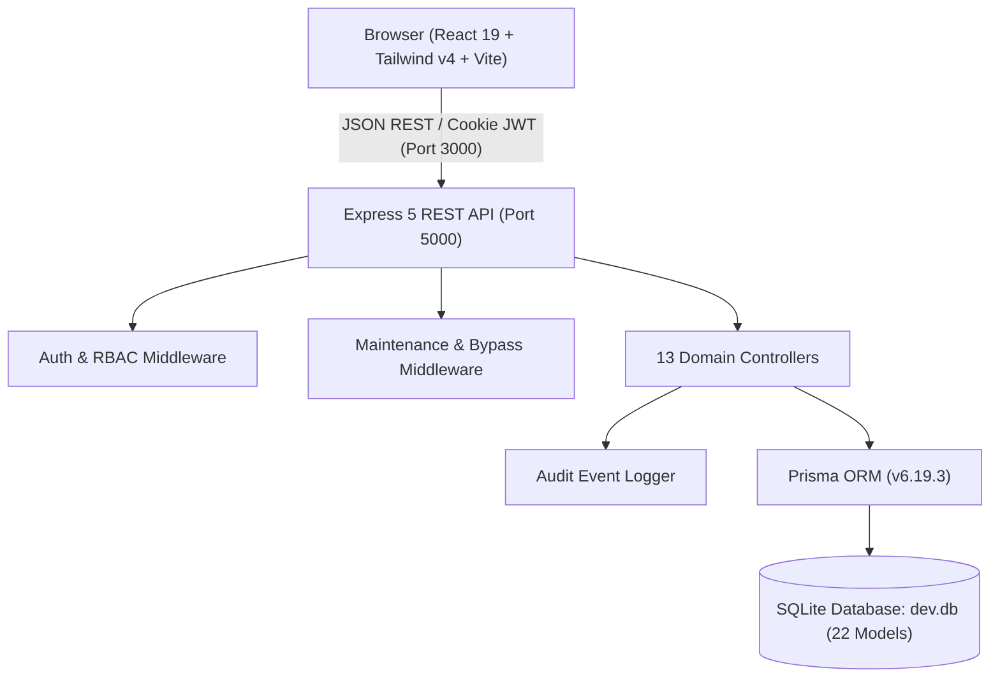

# AuraLMS — Master Engineering Blueprint & System Documentation
**Project Name:** AuraLMS  
**Release Version:** 2.0.0 Production Blueprint  
**Architecture:** Decoupled Full-Stack Web Application (Express 5 REST API + React 19 SPA + Prisma ORM + SQLite)  
**Location:** `d:\Projects\LMS\docs\`  

---

## Executive Summary

This documentation repository contains the complete, authoritative, and self-contained specifications required to **recreate, deploy, scale, and maintain AuraLMS from scratch at any time**. 

AuraLMS is a modern EdTech software engineering platform featuring industry-accredited course pathways, video classroom delivery with auto-graded quizzes, 15-minute doubt resolution SLAs, live workshop scheduling, anti-tamper payment activation, tamper-proof credential verification, and interactive UI visual signatures ("CodeByGaurav" style).

---

## Blueprint Navigation Index

| Document | Description | Format | Status |
| :--- | :--- | :--- | :--- |
| **[01_PRD.md](./01_PRD.md)** | **Product Requirements Document (PRD v2.0)**<br>Comprehensive 15-section product spec covering user personas, 6-role RBAC matrix, non-functional requirements, failure modes, bilingual EN/HI preferences, and UI reel visual requirements. | Markdown | Complete & Verified |
| **[02_SYSTEM_ARCHITECTURE_AND_DFD.md](./02_SYSTEM_ARCHITECTURE_AND_DFD.md)** | **System Architecture & Data Flow Diagrams**<br>Decoupled full-stack architecture, Level 0 Context Diagram, Level 1 System Decomposition, and Level 2 detailed process flows (Auth/OTP, Anti-Tamper Checkout, Classroom, Doubts, Support). | Mermaid / Markdown | Complete & Verified |
| **[03_CLASS_DIAGRAM.md](./03_CLASS_DIAGRAM.md)** | **UML Class Diagram**<br>Object-oriented domain model covering all 22 Prisma database models, relationships, field types, backend route controllers, security middlewares, and audit services. | Mermaid UML | Complete & Verified |
| **[04_OBJECT_DIAGRAM.md](./04_OBJECT_DIAGRAM.md)** | **UML Object Diagram**<br>Concrete runtime snapshot illustrating live interconnected instances across all 6 user roles (`studentUser`, `mentorUser`, `course1`, `order1`, `cert1`, `ticket1`, etc.). | Mermaid UML | Complete & Verified |
| **[05_DATABASE_ERD.md](./05_DATABASE_ERD.md)** | **Database ERD & Schema Catalog**<br>Complete relational Entity-Relationship Diagram mapping all 22 tables, column types, primary/foreign/unique keys, and comprehensive table dictionary. | Mermaid ERD | Complete & Verified |
| **[06_API_SPECIFICATION.md](./06_API_SPECIFICATION.md)** | **REST API Catalog & Contracts**<br>Catalog of all 50+ REST endpoints across 13 functional domains with required headers, request payloads, response schemas, and permission levels. | Markdown / JSON | Complete & Verified |
| **[07_THEMES_AND_DESIGN_SYSTEM.md](./07_THEMES_AND_DESIGN_SYSTEM.md)** | **Themes & Design System Specification**<br>Strict Light and Dark mode color tokens, typography scales, WCAG AA compliance, and CodeByGaurav signatures (`PointerLight`, `VerificationSpinner`, `OtpInputBoxes`). | Markdown | Complete & Verified |
| **[08_RECREATION_RUNBOOK.md](./08_RECREATION_RUNBOOK.md)** | **Recreation & Deployment Runbook**<br>Step-by-step developer guide to reconstruct the system from zero: prerequisites, package setup, `.env` config, Prisma migrations, database seeding, automated testing, and Nginx deployment. | Markdown / Bash | Complete & Verified |
| **[PAGE_VIEWS/](./PAGE_VIEWS/)** | **High-Fidelity SVG Page Views (27 Pages)**<br>Vector-sharp visual mockups for every single page across Public, Auth, Student, Mentor, Content Manager, Finance, Moderator, Admin, and Shared modules. | 27 SVG Files | Complete & Verified |
| **[PAGE_VIEWS/README.md](./PAGE_VIEWS/README.md)** | **Visual Gallery & Page Index**<br>Master index and technical description for all 27 vector page views. | Markdown | Complete & Verified |

---

## Core System Architecture Snapshot



---

## 6 Seeded Role Accounts Quick Reference

All demo accounts share the default development password: `Password123!`

1. **Super Admin**: `admin@lms.local` (`+10000000001`) — Full administrative oversight, maintenance toggle, audit trail, webhook simulator.
2. **Student**: `student@lms.local` (`+10000000002`) — Enrolled in CS101 & WEB201, classroom player, quizzes, certificates, doubt tickets.
3. **Mentor**: `mentor@lms.local` (`+10000000003`) — Doubt queue resolution, live workshop scheduling, student progress view.
4. **Content Manager**: `content@lms.local` (`+10000000004`) — Course curriculum editor, lesson video linking, quiz authoring.
5. **Finance Support**: `finance@lms.local` (`+10000000005`) — Transaction ledger, refund approvals, revenue analytics.
6. **Moderator**: `moderator@lms.local` (`+10000000006`) — Forum spam moderation, user strikes, flagged doubt tickets.

---

## Rebuilding the Software (Quick Command Summary)

```bash
# 1. Setup Backend
cd backend
npm install
npx prisma generate
npx prisma db push
npm run seed
npm run dev

# 2. Setup Frontend
cd ../frontend
npm install
npm run dev

# 3. Verify Entire Platform (All 6 Roles)
cd ..
node scratch/test_full_platform.cjs
```
